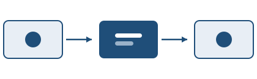

# Sintesi per la direzione

Questo documento riassume lo stato dei sistemi di continuità operativa al
termine del terzo trimestre. L'infrastruttura ha retto ai due eventi di
indisponibilità registrati a luglio, con un tempo di ripristino inferiore
all'obiettivo contrattuale in entrambi i casi.

La sillabazione automatica in italiano è attiva, così i paragrafi giustificati
non presentano spaziature irregolari anche in presenza di parole
particolarmente lunghe come *controdeterminazione* o *precipitevolissimevolmente*.

> Il tempo di ripristino medio è sceso da 47 a 18 minuti rispetto al trimestre
> precedente, principalmente grazie all'automazione della procedura di failover.

## Indicatori principali

I valori sotto riportati sono estratti dal sistema di monitoraggio e si
riferiscono al periodo luglio–settembre.

| Indicatore                    | Obiettivo |  Rilevato | Esito |
|:------------------------------|:---------:|----------:|:-----:|
| Disponibilità del servizio    |  99,50 %  |  99,82 %  |   ✓   |
| Tempo di ripristino medio     |  30 min   |    18 min |   ✓   |
| Backup verificati             |   100 %   |     100 % |   ✓   |
| Incidenti di sicurezza        |     0     |         1 |   ✗   |
| Copertura dei test automatici |   80 %    |      74 % |   ✗   |

## Interventi previsti

1. Completare la copertura dei test automatici entro dicembre.
2. Rivedere la procedura di gestione degli incidenti di sicurezza.
3. Estendere la replica geografica al secondo datacenter.

- Priorità alta
  - Revisione dei criteri di allerta
  - Formazione del personale di turno
- Priorità media
  - Consolidamento dei log applicativi

---

# Dettaglio tecnico

## Procedura di failover

Il controllo di integrità viene eseguito ogni trenta secondi. La soglia di
intervento è configurabile tramite la variabile `SOGLIA_LATENZA`, espressa in
millisecondi.

```python
def verifica_nodo(nodo: str, soglia_ms: int = 250) -> bool:
    """Restituisce True se il nodo risponde entro la soglia."""
    inizio = time.monotonic()
    try:
        risposta = requests.get(f"https://{nodo}/health", timeout=2.0)
    except requests.RequestException:
        return False
    latenza_ms = (time.monotonic() - inizio) * 1000
    return risposta.status_code == 200 and latenza_ms < soglia_ms
```

La configurazione corrispondente:

```yaml
failover:
  intervallo_controllo: 30s
  soglia_latenza_ms: 250
  tentativi_prima_di_promuovere: 3
```

## Glossario

RTO
: *Recovery Time Objective*, il tempo massimo accettabile di indisponibilità.

RPO
: *Recovery Point Objective*, la quantità massima di dati che si accetta di
  perdere.

## Schema dell'architettura



Il diagramma completo è disponibile nel repository interno[^1]. Le note a piè di
pagina sono numerate automaticamente e rimandano in fondo alla pagina corrente.

[^1]: Repository `infrastruttura/continuita-operativa`, cartella `docs/`.
